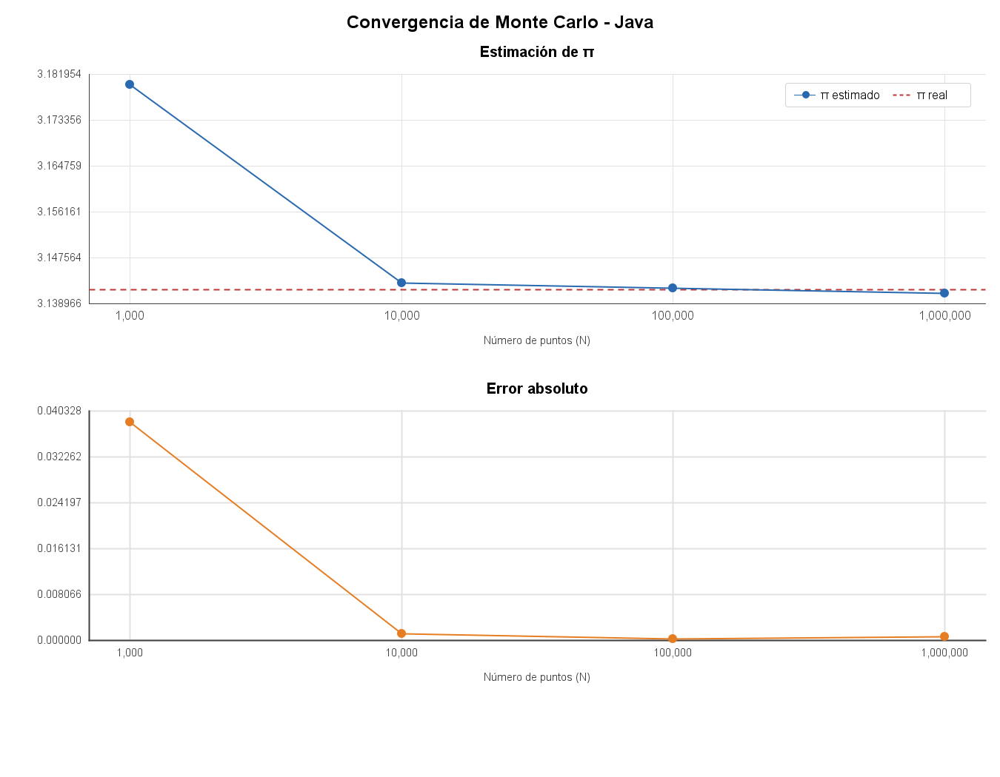

# APE7: Estimación de π mediante el método de Monte Carlo

## Objetivo

Implementar en Python y Java un experimento Monte Carlo que estime el valor de
π, analizar cómo cambia el error absoluto al aumentar el número de puntos y
comparar los resultados y tiempos de ejecución de ambos lenguajes.

## Estructura del proyecto

```text
APE7/
├── README.md
├── requirements.txt
├── Documento/
├── Guia/
├── img/
│   ├── convergencia_python.png
│   ├── convergencia_java.png
│   └── comparativa_java_python.png
├── java/
│   ├── Main.java
│   ├── controlador/
│   │   └── MonteCarloController.java
│   ├── modelo/
│   │   └── MonteCarloModel.java
│   ├── output/
│   │   └── resultados_java.csv       # Se genera al ejecutar Java
│   └── vista/
│       └── MonteCarloView.java
└── python/
    ├── main.py
    ├── controlador/
    │   └── monte_carlo_controller.py
    ├── modelo/
    │   └── monte_carlo_model.py
    └── vista/
        └── monte_carlo_view.py
```

### Responsabilidad de cada archivo

- `python/modelo/monte_carlo_model.py`: genera puntos aleatorios, calcula la
  estimación de π, el error absoluto y el tiempo de ejecución en Python.
- `python/controlador/monte_carlo_controller.py`: ejecuta el modelo para los
  cuatro tamaños de muestra y reúne los resultados.
- `python/vista/monte_carlo_view.py`: genera la gráfica Python y la comparativa
  Java-Python en `img/`, leyendo los resultados Java del CSV.
- `python/main.py`: ejecuta las simulaciones, imprime la tabla de Python y
  solicita a la vista la generación de las gráficas.
- `java/Main.java`: inicia la simulación y delega la presentación en la vista
  gráfica después de imprimir la tabla.
- `java/controlador/MonteCarloController.java`: coordina las simulaciones Java
  y reúne sus resultados.
- `java/modelo/MonteCarloModel.java`: genera puntos aleatorios y calcula la
  estimación de π, el error absoluto y el tiempo en Java.
- `java/vista/MonteCarloView.java`: guarda los resultados Java en CSV y crea la gráfica de
  convergencia Java con Java2D.
- `requirements.txt`: declara NumPy, Pandas y Matplotlib.

## Parámetros y fórmula

| Parámetro | Valor |
|-----------|-------|
| Tamaños de muestra (`N`) | `1000`, `10000`, `100000`, `1000000` |
| Dominio de los puntos | Cuadrado unitario `[0, 1) × [0, 1)` |
| Radio del cuarto de círculo | `1` |
| Valor de referencia de π | `3.141592653589793` |

Se generan `N` puntos uniformes `(x, y)` en el cuadrado unitario. Un punto está
dentro del cuarto de círculo cuando `x² + y² ≤ 1`. Si `Nc` es la cantidad de
puntos dentro, la estimación y el error absoluto son:

```text
π_estimado = 4 · Nc / N
error_absoluto = |π - π_estimado|
```

Los generadores aleatorios de Python y Java son independientes y no usan una
semilla común. Por eso las secuencias y las estimaciones pueden diferir entre
ejecuciones; aumentar `N` mejora la precisión esperada, pero no garantiza que
cada resultado individual esté más cerca de π.

## Instalación y ejecución

Se requiere Python 3 y un JDK instalado. Desde la raíz del proyecto:

### Java

Con JDK 22 o superior, puedes ejecutar todo desde la carpeta `java` con el
lanzador de archivos fuente. Compila las clases necesarias al vuelo, sin
carpeta `out` ni archivos `.class` previos:

```powershell
Push-Location .\java
java Main.java
Pop-Location
```

`Main` imprime la tabla y llama a `MonteCarloView`, que crea
`img/convergencia_java.png` y guarda `java/output/resultados_java.csv`.

### Python

```powershell
python -m venv .venv
.\.venv\Scripts\Activate.ps1
python -m pip install -r requirements.txt
python .\python\main.py
```

Ejecuta Java primero. Python imprime sus resultados, lee el CSV creado por Java
y genera `img/convergencia_python.png` e
`img/comparativa_java_python.png`. En total, ambas ejecuciones generan las tres
gráficas de `img/`. Si el CSV no existe o no contiene los cuatro tamaños de
muestra esperados, Python informa el error.

## Resultados, gráficas y conclusiones

La tabla corresponde a una ejecución de Java seguida por Python. Las imágenes
Java y Python se generan con esos resultados de ejecución; por la naturaleza
aleatoria del método, una nueva ejecución puede producir valores y tiempos
distintos.

| N | π estimado Python | Error Python | Tiempo Python (ms) | π estimado Java | Error Java | Tiempo Java (ms) |
|---:|---:|---:|---:|---:|---:|---:|
| 1,000 | 3.052000 | 0.089593 | 160.03 | 3.136000 | 0.005593 | 1 |
| 10,000 | 3.139600 | 0.001993 | 1.05 | 3.158800 | 0.017207 | 2 |
| 100,000 | 3.146280 | 0.004687 | 11.33 | 3.142360 | 0.000767 | 11 |
| 1,000,000 | 3.140472 | 0.001121 | 277.99 | 3.144736 | 0.003143 | 57 |

### Convergencia en Python

La gráfica presenta la estimación de π y su error absoluto para los cuatro
tamaños de muestra. En esta ejecución, el menor error se obtuvo con
`N = 1000000`.


### Convergencia en Java

La vista Java genera esta gráfica junto con la simulación. En esta ejecución,
el menor error Java se obtuvo con `N = 100000`.



### Conclusiones

- Al aumentar la muestra, la estimación suele acercarse a π, pero el error no
  tiene que disminuir en cada paso.
- En esta ejecución, el menor error Python se observó en `N = 1000000` y el
  menor error Java en `N = 100000`.
- La comparación de tiempos es orientativa; los programas usan estrategias
  distintas y las mediciones dependen del entorno de ejecución.
