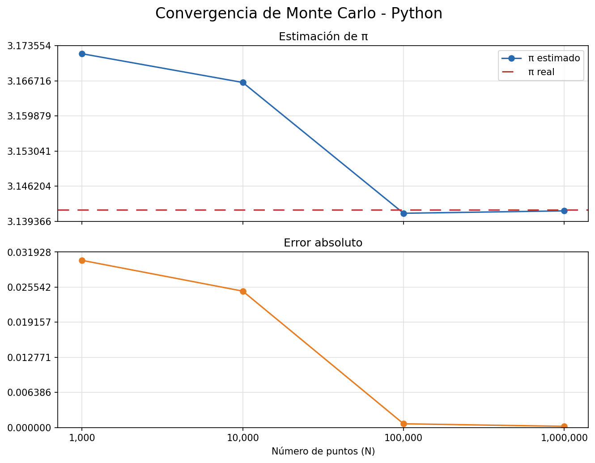
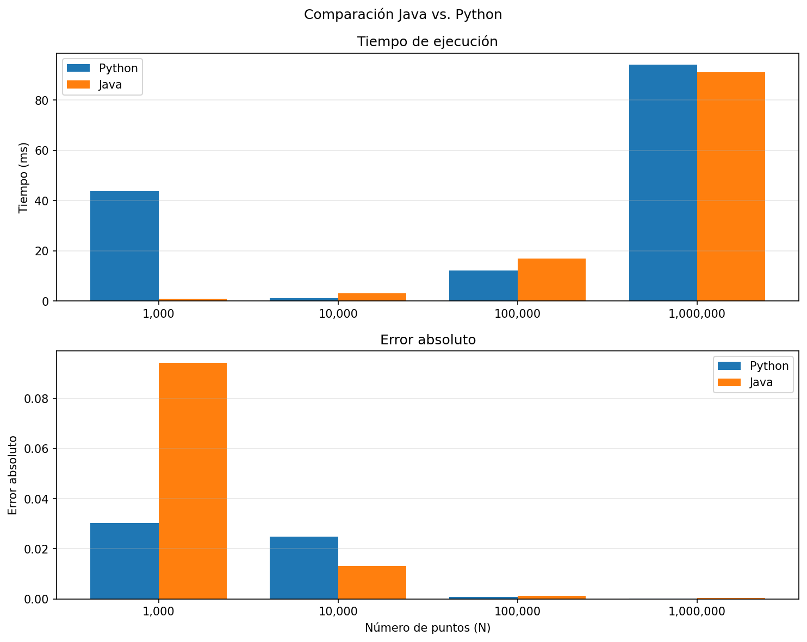

# APE7: Estimación de π mediante el método de Monte Carlo

## Objetivo

Implementar en Python y Java un experimento Monte Carlo que estime el valor de
π, analizar cómo cambia el error absoluto al aumentar el número de puntos y
comparar los resultados y tiempos de ejecución de ambos lenguajes.

## Estructura del proyecto

```text
APE7/
├── README.md
├── requirements.txt
├── Documento/
├── Guia/
├── img/                              # Se genera al ejecutar Java y Python
│   ├── convergencia_python.png
│   ├── convergencia_java.png
│   └── comparativa_java_python.png
├── java/
│   ├── Main.java
│   ├── controlador/
│   │   └── MonteCarloController.java
│   ├── modelo/
│   │   └── MonteCarloModel.java
│   ├── output/
│   │   └── resultados_java.csv       # Se genera al ejecutar Java
│   └── vista/
│       └── MonteCarloView.java
└── python/
    ├── main.py
    ├── controlador/
    │   └── monte_carlo_controller.py
    ├── modelo/
    │   └── monte_carlo_model.py
    └── vista/
        └── monte_carlo_view.py
```

### Responsabilidad de cada archivo

- `python/modelo/monte_carlo_model.py`: genera puntos aleatorios, calcula la
  estimación de π, el error absoluto y el tiempo de ejecución en Python.
- `python/controlador/monte_carlo_controller.py`: ejecuta el modelo para los
  cuatro tamaños de muestra y reúne los resultados.
- `python/vista/monte_carlo_view.py`: genera la gráfica Python y la comparativa
  Java-Python en `img/`, leyendo los resultados Java del CSV.
- `python/main.py`: ejecuta las simulaciones, imprime la tabla de Python y
  solicita a la vista la generación de las gráficas.
- `java/Main.java`: inicia la simulación y delega la presentación en la vista
  Java.
- `java/controlador/MonteCarloController.java`: coordina las simulaciones Java
  y reúne sus resultados.
- `java/modelo/MonteCarloModel.java`: genera puntos aleatorios y calcula la
  estimación de π, el error absoluto y el tiempo en Java.
- `java/vista/MonteCarloView.java`: presenta en consola la tabla de resultados
  generada por Java, guarda sus resultados en CSV y crea la gráfica de
  convergencia Java con Java2D.
- `requirements.txt`: declara NumPy, Pandas y Matplotlib.

## Parámetros y fórmula

| Parámetro | Valor |
|-----------|-------|
| Tamaños de muestra (`N`) | `1000`, `10000`, `100000`, `1000000` |
| Dominio de los puntos | Cuadrado unitario `[0, 1) × [0, 1)` |
| Radio del cuarto de círculo | `1` |
| Valor de referencia de π | `3.141592653589793` |

Se generan `N` puntos uniformes `(x, y)` en el cuadrado unitario. Un punto está
dentro del cuarto de círculo cuando `x² + y² ≤ 1`. Si `Nc` es la cantidad de
puntos dentro, la estimación y el error absoluto son:

```text
π_estimado = 4 · Nc / N
error_absoluto = |π - π_estimado|
```

Los generadores aleatorios de Python y Java son independientes y no usan una
semilla común. Por eso las secuencias y las estimaciones pueden diferir entre
ejecuciones; aumentar `N` mejora la precisión esperada, pero no garantiza que
cada resultado individual esté más cerca de π.

## Instalación y ejecución

Se requiere Python 3 y un JDK instalado. Desde la raíz del proyecto:

### Java

```powershell
javac -encoding UTF-8 -d .\out .\java\Main.java .\java\controlador\MonteCarloController.java .\java\modelo\MonteCarloModel.java .\java\vista\MonteCarloView.java
java -cp .\out Main
```

`Main` entrega los resultados del controlador a `MonteCarloView`. La vista
imprime la tabla, crea `img/convergencia_java.png` y guarda
`java/output/resultados_java.csv` para que Python pueda usar los mismos datos.
Si estás en la carpeta `java`, primero recompila las clases antes de ejecutar
`java -cp . Main`; el comando `java` no compila automáticamente los archivos
`.java`:

```powershell
javac -encoding UTF-8 Main.java controlador\MonteCarloController.java modelo\MonteCarloModel.java vista\MonteCarloView.java
java -cp . Main
```

También puedes compilar desde la raíz con el primer comando y ejecutar con
`java -cp .\out Main`.

### Python y comparación

```powershell
python -m venv .venv
.\.venv\Scripts\Activate.ps1
python -m pip install -r requirements.txt
python .\python\main.py
```

Ejecuta Java primero. Python imprime sus resultados, lee el CSV creado por Java
y genera `img/convergencia_python.png` e
`img/comparativa_java_python.png`. En total, ambas ejecuciones generan las tres
gráficas de `img/`. Si el CSV no existe o no contiene los cuatro tamaños de
muestra esperados, Python informa el error.

## Resultados, gráficas y conclusiones

La tabla muestra una ejecución Java seguida de una ejecución Python. Las
gráficas Java se generan con los resultados de esa ejecución Java, y la
comparativa consume el CSV producido por Java. Los tiempos se expresan en
milisegundos. Como ambos programas usan muestras aleatorias, al volver a
ejecutarlos se actualizan las gráficas y los valores de la tabla pueden cambiar.

| N | π estimado Python | Error Python | Tiempo Python (ms) | π estimado Java | Error Java | Tiempo Java (ms) |
|---:|---:|---:|---:|---:|---:|---:|
| 1,000 | 3.156000 | 0.014407 | 51.48 | 3.120000 | 0.021593 | 2 |
| 10,000 | 3.165200 | 0.023607 | 0.98 | 3.140800 | 0.000793 | 3 |
| 100,000 | 3.141520 | 0.000073 | 12.85 | 3.140760 | 0.000833 | 19 |
| 1,000,000 | 3.140332 | 0.001261 | 83.35 | 3.140064 | 0.001529 | 109 |

### Convergencia en Python

En esta ejecución el error Python fue menor con `N = 100000` y subió para
`N = 1000000`. El método converge en términos probabilísticos, pero no
garantiza que cada aumento de la muestra mejore la estimación observada.



### Convergencia en Java

La vista Java genera esta gráfica al ejecutar `Main`, con las estimaciones y
errores calculados por esa ejecución. En esta corrida, el menor error se obtuvo
con `N = 10000`.


### Comparación de tiempos y errores

En los valores de esta tabla, Java presentó menor tiempo para `N = 1000`;
Python fue más rápido para `N = 10000`, `100000` y `1000000`.
Estas mediciones son de una sola ejecución y no constituyen una comparación
controlada: Python usa operaciones vectorizadas de NumPy y Java recorre los
puntos en un bucle.



### Conclusiones

- La simulación aproxima π contando los puntos que caen dentro del cuarto de
  círculo y aplica correctamente la fórmula de Monte Carlo.
- En esta ejecución, el menor error Python se obtuvo con `N = 100000`, y el
  menor error Java con `N = 10000`. El error no disminuye necesariamente en
  cada tamaño; el muestreo es aleatorio.
- Java tuvo menor tiempo para `N = 1000`, y Python para los otros tres tamaños.
  Los tiempos pueden variar por el equipo, el estado del proceso y las
  diferencias de implementación entre el bucle Java y NumPy.
- Python y Java generan muestras independientes, por lo que no se espera que
  coincidan punto por punto. Para exigir la misma secuencia, habría que definir
  y compartir explícitamente el algoritmo generador y su semilla.

### Nota sobre la guía

La metodología de la guía solicita estimar π mediante Monte Carlo, que es lo
que implementa este proyecto. Sin embargo, un criterio de la rúbrica menciona
el modelo de colas M/M/1, que no aparece en el procedimiento descrito y no está
implementado aquí. Si la evaluación exige literalmente M/M/1, se necesita
aclarar ese alcance con el docente; no es el modelo de esta práctica de
estimación de π.

## Pruebas

No se incluyen pruebas automatizadas en el proyecto. La ejecución de
Java seguida de `python .\python\main.py` valida ambas simulaciones, la
transferencia de resultados mediante CSV y la creación de las tres imágenes.
